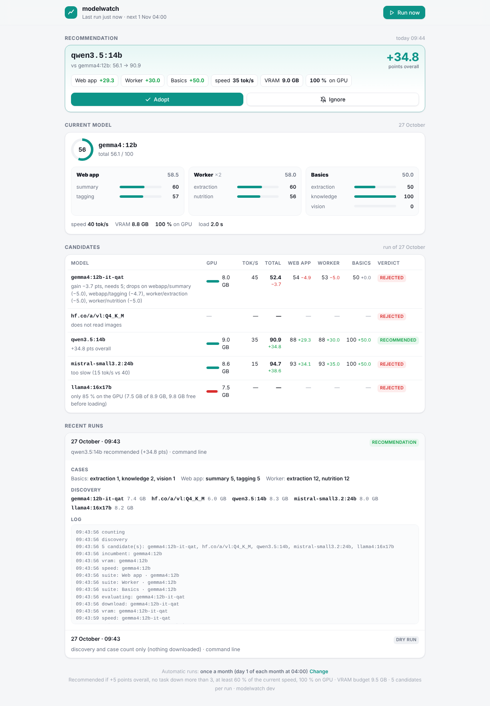
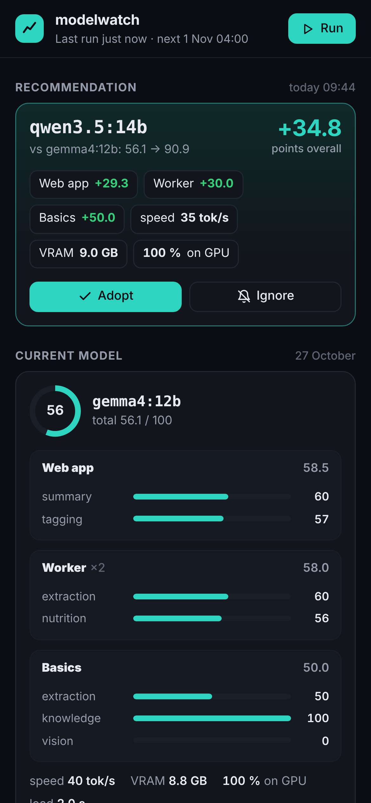

# modelwatch

> **What's modelwatch?** Is there a better local model for *your* apps? Scored
> on your own tasks, one tap to switch.

Your apps share one Ollama and one model. New models come out every week,
and leaderboards don't tell you whether one would read *your* recipes,
file *your* invoices or fit on *your* card. modelwatch finds out, once a
month: it downloads the candidates that fit your GPU, **measures** the VRAM
they really take, lets **each of your apps score them on its own tasks**,
and only bothers you when one is clearly better. Then you switch every app
(or roll back) from your phone.

<p align="center">
  
  &nbsp;
  
</p>

## Features

- **Your tasks, your data.** Every app scores the models with its own
  prompts on cases a human already checked: an HTTP endpoint, a script run
  with `docker exec`, declarative test cases, or a plugin
  ([Paperless-ngx](plugins/paperless.py) is built in). One small JSON
  contract for all ([docs/integration.md](docs/integration.md)).
- **Real fit, not file sizes.** Each candidate is loaded alone with your
  context window: it must sit 100 % on the GPU and stay under your VRAM
  budget. modelwatch learns how much VRAM is really free and stops pulling
  models that cannot fit.
- **Careful verdicts.** Recommended only if clearly better overall, worse on
  no task, and fast enough. The current model is scored on exactly the same
  cases (and cached while nothing changes).
- **Discovery.** Curated families, ollama.com pages ranked by pulls, new
  variants of your current family, and any extra model you name, including
  GGUF repositories on Hugging Face (`hf.co/...`). Formats your card cannot
  run (nvfp4, fp8, mlx) and other names of a model you have are skipped.
- **Never in the way.** Waits until the GPU is idle (nothing loaded in
  Ollama, plus your own "busy" probes), never deletes a model you had,
  deletes the candidates it pulled once scored.
- **One-tap switch from ntfy.** **Adopt**, **Details** and **Ignore**
  buttons on signed, single-use, expiring links. Adopt edits your apps'
  `.env` files and recreates their services with their own compose files,
  then offers **Revert**. No adopt target? You get recommendations only.
- **A web interface** (phone first, light and dark, English and French):
  the recommendation, your current model's score per app and task, every
  candidate with its verdict and reason, run history with logs, *run now*,
  and the run frequency.
- **Small.** One Python file with no dependencies, one HTML page, on the
  `docker:cli` image.

## Quick start

```yaml
services:
  modelwatch:
    image: ghcr.io/lguerard/modelwatch:latest
    container_name: modelwatch
    environment:
      - TZ=Europe/Paris
      - MODELWATCH_SECRET=change-me                   # openssl rand -hex 32
      - MODELWATCH_NTFY_TOPIC=pick-a-long-random-topic  # openssl rand -hex 16
      - MODELWATCH_PUBLIC_URL=http://my-server:8097     # how your PHONE reaches modelwatch
    volumes:
      - ./config:/config:ro     # modelwatch.yml
      - ./data:/data
    ports:
      - "8097:8097"
    networks: [default, ollama]   # wherever http://ollama:11434 resolves
    restart: unless-stopped
networks:
  ollama:
    external: true
```

1. Copy [examples/minimal.yml](examples/minimal.yml) to `config/modelwatch.yml`
   (and [examples/cases/](examples/cases) to `config/cases/`), set
   `current_model` to the model your apps use.
2. Subscribe to your topic in the [ntfy](https://ntfy.sh) app.
3. `docker compose up -d`, open `http://my-server:8097`, press **Run now**.
4. Replace the example suites with your apps (see [Suites](#suites)).

To check without downloading anything:
`docker exec modelwatch python3 /app/modelwatch.py --dry-run` lists the
candidates and every suite's case count. `--check-config` prints the
configuration as modelwatch understood it.

> **The Docker socket** is only needed for `exec` suites and probes,
> nvidia-smi inside a container, and **Adopt**. Mount it then (see
> [Security](#security)).

## How a model is judged

A run (the 1st of the month at 04:00 by default):

1. **Waits for an idle GPU**: no model loaded in Ollama except embedding
   models, and every configured probe idle. Retries every 15 min, gives up
   after 3 h (noted in the interface, no notification).
2. **Reads the current model**: the first key of the first adopt target's
   `.env` file, else `current_model`. Warns when your apps disagree.
3. **Counts the cases** of every suite (a *dry run*: no model called).
4. **Discovers candidates**: your extra models and your current family
   first, then curated families, then ollama.com (most pulled first, at
   least `min_pulls`). The size comes from the registry manifest; a model
   must weigh at most `vram_budget_gb` − 1 GB and `max_download_gb`.
   `max_candidates` per run (up to `per_family` sizes of each family); already-scored ones (same digest, same cases),
   ignored ones and models that did not fit before are skipped.
5. **Evaluates each candidate**: pull; check its capabilities
   (`required_capabilities`, e.g. vision); unload everything, load it alone
   with `num_ctx` and **measure** its share on the GPU (`/api/ps`) and the
   VRAM taken (nvidia-smi, when available); measure its speed; run every
   suite.
6. **Scores the current model** on the same cases (cached while its digest
   and the cases do not change).
7. **Decides.** Each suite's score is the mean of its tasks; the total is
   the suites' mean, weighted by `weight`. A candidate is compared only on
   the tasks both models have scored, and is **recommended** if:
   - it fits 100 % on the GPU (`require_full_gpu`) within the budget;
   - its total is at least `min_improvement` points higher (5);
   - it drops more than `max_regression` points (3) on **no** task;
   - it keeps `min_speed_ratio` (60 %) of the current speed.

   The best recommended candidate stays downloaded; the others are deleted.
8. **Notifies** only when there is a recommendation, or something to look
   at (apps on different models, every suite failing). A month without a
   better model stays silent: everything is in the interface.

## Configuration

`/config/modelwatch.yml` (or `.yaml`, or `modelwatch.json`; another path
with `MODELWATCH_CONFIG`). Everything has a default. `${VAR}` references
are expanded from the environment (`${VAR:-default}`, `$$` for a literal
`$`), so secrets can stay in your compose file. Relative paths are relative
to the configuration file.

```yaml
schedule: "1 04:00"          # see Run frequency
port: 8097
state_file: /data/state.json
secret: ${MODELWATCH_SECRET}
current_model: gemma3:12b    # when no adopt target says otherwise
max_cases: 12                # passed to suites as {max_cases}
run_on_start: false

ollama:
  url: http://ollama:11434
  num_ctx: 8192              # your apps' context window: the fit is measured with it
  embed_models: [nomic-embed-text]   # loaded but not "busy", never candidates
  gpu_memory:                # where nvidia-smi runs, to measure the VRAM really used
    mode: auto               # auto (local if present) | local | docker | none (Ollama's /api/ps only)
    container: {project: ollama, service: ollama}   # for docker: a name, {project, service} or {labels}
  speed_prompt: Describe, step by step and in one paragraph, how to make pancake batter.

idle:
  retry_minutes: 15
  max_hours: 3
  probes: []                 # see Busy probes

discovery:
  families: [gemma4, gemma3, qwen3.5, qwen3-vl, …]   # curated (default list in modelwatch.py)
  search_pages: null         # default: ollama.com newest + popular, vision-filtered if vision is required
  min_pulls: 20000
  extra_models: []           # e.g. [hf.co/org/repo-GGUF:Q4_K_M, name:tag]
  vram_budget_gb: 9.5
  max_download_gb: 12
  max_candidates: 12
  per_family: 3              # biggest fitting sizes tried per family
  required_capabilities: [completion, vision]   # [completion] for text-only apps

suites: []                   # see Suites

decision:
  min_improvement: 5
  max_regression: 3
  min_speed_ratio: 0.6
  require_full_gpu: true

adopt:
  targets: []                # see Adopt; empty = recommendations only
  rollback_days: 7
  health_timeout: 180        # seconds for a recreated service to be up (and healthy)
  settle_seconds: 10         # ...and to stay up

notify:
  ntfy: {url: https://ntfy.sh, topic: "", token: ""}
  webhook: {url: "", headers: {}}

ui:
  password: ""               # HTTP Basic, any user name
  language: en               # en or fr: interface, notifications, reasons
  public_url: http://localhost:8097   # how your phone reaches modelwatch (buttons)
```

**Environment variables** override the file (an empty variable is
ignored), for docker-compose users:

| Variable | Setting |
|---|---|
| `MODELWATCH_CONFIG` | path of the configuration file |
| `MODELWATCH_SECRET` | `secret` (**required** to serve) |
| `MODELWATCH_PUBLIC_URL`, `MODELWATCH_UI_PASSWORD`, `MODELWATCH_LANG` | `ui.public_url`, `ui.password`, `ui.language` |
| `MODELWATCH_NTFY_URL`, `MODELWATCH_NTFY_TOPIC`, `MODELWATCH_NTFY_TOKEN`, `MODELWATCH_WEBHOOK_URL` | `notify.*` |
| `MODELWATCH_SCHEDULE`, `MODELWATCH_RUN_ON_START`, `MODELWATCH_PORT`, `MODELWATCH_STATE_FILE` | top level |
| `MODELWATCH_CURRENT_MODEL`, `MODELWATCH_MAX_CASES` | top level |
| `MODELWATCH_OLLAMA_URL`, `MODELWATCH_NUM_CTX`, `MODELWATCH_EMBED_MODELS` | `ollama.*` |
| `MODELWATCH_VRAM_BUDGET_GB`, `MODELWATCH_MAX_DOWNLOAD_GB`, `MODELWATCH_MAX_CANDIDATES`, `MODELWATCH_MIN_PULLS`, `MODELWATCH_EXTRA_MODELS`, `MODELWATCH_FAMILIES`, `MODELWATCH_REQUIRED_CAPABILITIES` | `discovery.*` (lists comma-separated) |
| `MODELWATCH_MIN_IMPROVEMENT`, `MODELWATCH_MAX_REGRESSION`, `MODELWATCH_MIN_SPEED_RATIO`, `MODELWATCH_REQUIRE_FULL_GPU` | `decision.*` |
| `MODELWATCH_IDLE_RETRY_MIN`, `MODELWATCH_IDLE_MAX_HOURS` | `idle.*` |

### Why a YAML subset (and JSON)

modelwatch is one dependency-free Python file, and Python has no YAML
parser. So it reads **JSON always**, and **a strict, documented subset of
YAML** with its own small parser (tested against PyYAML on every example):

- block mappings and lists, `- key: value` items, comments, a leading `---`;
- plain, `'single'` and `"double"` quoted scalars **on one line**;
- one-line flow collections: `[a, b]`, `{project: x, service: y}`;
- `|` and `>` block scalars (with `-` / `+`), for prompts and scripts;
- YAML 1.2 core types: `null`/`~`, `true`/`false`, plain integers and
  floats; everything else is a string (`yes`, `on`, `04:00`, `0x1F`…).

Refused, with the line number: anchors and aliases (`&`, `*`), tags (`!`),
several documents, multi-line quoted strings or flow collections, an
unquoted `: ` inside a value. Quote strings that start with `{`, `[`, `*`
or `&` (placeholders: `"{model}"`). A file that starts with `{` is read as
JSON.

### Run frequency

`schedule` takes comma-separated items, local time (`TZ`): `1 04:00` (a day
of the month), `sun 04:00` (`mon`…`sun`, or `lun`…`dim`), `04:00` (every
day), `every 6h` (1, 2, 3, 4, 6, 8 or 12, from 04:00). It can be changed in
the interface (**Change**, at the bottom): stored in `/data`, no restart.

### Busy probes

Ollama's `/api/ps` is always checked. Add probes for GPU work Ollama does
not see (transcription, image generation, a job queue):

```yaml
idle:
  probes:
    - name: jobs                       # a command inside a container
      type: exec
      container: {project: myapp, service: db}
      command: [psql, -U, myapp, -Atc, "SELECT count(*) FROM jobs WHERE running"]
      busy_when: {number_above: 0}     # or {matches: regex}, {exit_code: 0} (default), {json_field: busy}
      message: "myapp is running {output} job(s)"
    - name: video                      # a process running in a container (docker top)
      type: exec
      container: {project: myapp, service: worker}
      processes: '\b(ffmpeg|whisper)\b'
    - name: api                        # an HTTP check
      type: http
      url: http://myapp:3000/api/gpu-busy
      busy_when: {json_field: busy}    # default; or {status: 423}, {json_field: state, equals: running}
```

A probe whose container is missing counts as idle; a probe that crashes is
logged and ignored.

## Suites

Each suite has a `name` (unique), an optional `label` (shown), a `weight`
(1), optional `task_labels` (`{task: shown name}`), `max_cases` and
`timeout`, and a `type`. Every suite answers with the **suite result
contract**, the integration spec for your apps:
[docs/integration.md](docs/integration.md), with Python, Node and curl
examples.

| Type | For | Needs |
|---|---|---|
| `http` | an app that exposes an evaluation endpoint | the URL reachable from modelwatch |
| `exec` | an app that can run an evaluation script in its container | the Docker socket |
| `cases` | prompts with known answers, no code | nothing |
| `paperless` | Paperless-ngx: metadata suggestion and OCR, ground truth from your database | the Docker socket |
| *anything* | your own [Python plugin](docs/integration.md#python-plugins) | |

```yaml
suites:
  - name: recipes
    type: http
    url: http://recipes:8000/api/model-eval
    headers: {Authorization: "Bearer ${RECIPES_EVAL_TOKEN}"}
    body: {model: "{model}", max_cases: "{max_cases}", dry: "{dry}"}   # the default
  - name: knitting
    type: exec
    container: {project: knitting, service: app}       # or a container name
    command: [python, -m, app.model_eval, --model, "{model}", --max-cases, "{max_cases}"]
    dry_args: [--cases-only]
    weight: 2
  - name: paperless
    type: paperless
    db_container: paperless-db
    web_container: paperless
    exclude_tags: ["paperless-gpt%"]   # never score a model on what an AI filed
```

### Cases suites

Prompts with known answers, sent to Ollama by modelwatch itself (temperature
0), inline or from a file (`file: cases/mine.yml`, a list or `{defaults,
cases}`):

```yaml
  - name: basics
    type: cases
    system: You extract information from documents. Answer with JSON only.   # default for the cases
    cases:
      - id: invoice              # default: case-N
        task: extraction         # cases are grouped by task (default: "cases")
        weight: 2                # within the task
        prompt: |
          Extract "vendor" and "total" (a number) from: EDF, invoice 778, total 45,20 EUR.
        images: [cases/invoice.png]   # optional, relative to the file
        schema: {type: object}   # optional: Ollama's structured output (or format: json)
        scorer: json_fields
        fields:
          vendor: EDF                                       # exact (strings), set (lists), numeric (numbers)
          total: {expect: 45.2, match: numeric, tolerance: 0.01, weight: 2}
      - prompt: What colour is the shape? One word.
        images: [cases/red-circle.png]
        scorer: exact
        expect: red
```

| Scorer | Score |
|---|---|
| `exact` | 100 if the reply equals `expect` (or one of a list), ignoring case, accents and punctuation (`normalize: false` for a strict comparison). |
| `contains` | share of `expect` items found in the reply (same normalisation). |
| `regex` | share of `expect` patterns found (case-insensitive unless `ignore_case: false`). |
| `similarity` | similarity to `expect`, 0–100 (characters for short texts, words for long ones); `threshold: 0.9` turns ≥ 90 % into 100. |
| `numeric` | 100 if the first number of the reply (`45,20` or `45.20`) is within `tolerance` (absolute) or `tolerance_pct` of `expect`, else 0. |
| `json_fields` | the reply's JSON object, field by field (`a.b` for nested fields): per-field `match` (`exact`, `contains`, `regex`, `similarity`, `numeric`, `set` = Jaccard of lists), `tolerance` and `weight`. Unreadable JSON = failed case. |

Any scorer except `json_fields` can score one field of a JSON reply with
`field: total`.

## Adopt

```yaml
adopt:
  targets:
    - name: recipes                       # shown in notifications
      env_file: /opt/stacks/recipes/.env  # the first key of the first target is the current model
      keys: [OLLAMA_MODEL]
      services: [{project: recipes, service: backend}]   # recreated, by compose labels (or a name)
      health: {url: "http://recipes:8000/health", status: 200, timeout: 120}   # optional
    - name: documents
      env_file: /opt/stacks/paperless/.env
      keys: [PAPERLESS_AI_LLM_MODEL, PAPERLESS_GPT_LLM_MODEL]
      services: [paperless, {project: paperless, service: paperless-gpt}]
```

**Adopt** (button, notification or interface) pulls the model if needed,
writes it into every target's keys (comments and other lines untouched, a
`<file>.modelwatch.bak` copy next to it), recreates each service with `docker
compose up -d --no-deps --no-build` **using the compose files recorded in
its labels** (as updock does), waits until it runs (and is healthy) and the
health URLs answer, then notifies with a **Revert** button (valid
`rollback_days`). Revert writes the old model back and ignores the reverted
one from then on. The old model is **never deleted automatically**.

> **Mount your stacks at the same path, read-write.** The compose labels
> hold absolute host paths: the `.env` files, the compose files and
> anything they refer to must be visible inside modelwatch at the very same
> path.

Without targets, the Adopt button is hidden and notifications say what to
switch to.

## Notifications

- **ntfy**: `notify.ntfy` (topic, your own server, an access token).
  Buttons: **Adopt**, **Details**, **Ignore**; after an adoption, **Revert**.
- **webhook**: `notify.webhook.url` receives a JSON `POST` for each event,
  with optional `headers`:

  ```json
  {"event": "recommendation", "title": "Model recommended: qwen3.5:14b", "message": "…",
   "priority": 3, "tags": ["sparkles"], "click": "http://my-server:8097",
   "actions": [{"label": "Adopt", "url": "http://my-server:8097/adopt/…", "method": "POST"}],
   "model": "qwen3.5:14b", "incumbent": "gemma4:12b", "delta": 7.5}
  ```

  Events: `recommendation`, `attention`, `adopted`, `reverted`, `failed`. The
  action URLs are the same signed links: a `POST` to one acts.

Both can be on at the same time. With neither, modelwatch only logs.

## Security

modelwatch can hold the Docker socket **with write access** to run
evaluations and recreate services: that is root on the host. It also
edits your apps' `.env` files. Keep it private.

- **Never expose port 8097 to the Internet** (no public reverse proxy, no
  tunnel). Reach it over your LAN or a VPN.
- Notification buttons are HMAC-signed links (`secret`), single-use, valid
  7 days, bound to one action and one model.
- The web API only answers requests carrying an `X-Modelwatch` header. A
  page from another site cannot send one without a CORS preflight, which
  modelwatch never grants: visiting a malicious page cannot adopt a model.
- Set `ui.password` if other people use your network.
- On ntfy.sh a topic is public to whoever knows its name: pick a long random
  one, or reserve it and use a token.
- Without `exec` suites, probes or adopt targets, do not mount the socket at
  all: modelwatch then only talks to Ollama and the web.
- Suite tokens: keep them in the environment (`${VAR}`), not in the file.

## Development

```sh
python3 modelwatch.py --selftest      # dependency-free tests (YAML subset, config, scorers, suites, adopt…)
python3 tests/e2e/run_e2e.py          # a full run against fake Ollama, registry, ntfy, suites and docker
python3 modelwatch.py --dry-run       # discovery and case counts with your configuration
python3 modelwatch.py --run           # one full run, now
```

The end-to-end test needs nothing but Python: fake Ollama, ollama.com,
registry, ntfy, webhook, an HTTP suite, an `exec` suite through a fake
`docker` CLI, and a cases suite; it adopts and reverts on temporary `.env`
files. Screenshots: `python3 tests/screenshots/serve_demo.py` then
`node tests/screenshots/shoot.js <url> docs/` (Playwright).

Commits follow [Conventional Commits](https://www.conventionalcommits.org)
(`feat(suites): …`, `fix(ui): …`, optionally with a gitmoji after the colon):
release notes are generated from them by [git-cliff](https://git-cliff.org)
(`cliff.toml`).

Every push to `main` publishes `:edge`. To release, push a tag
(`git tag v0.2.0 && git push origin v0.2.0`) or run **Actions → Release → Run
workflow** with the version: either way you get `:0.2.0`, `:0.2`, `:0`,
`:latest` (amd64 + arm64) and a GitHub release with the changelog.

## License

[MIT](LICENSE)
